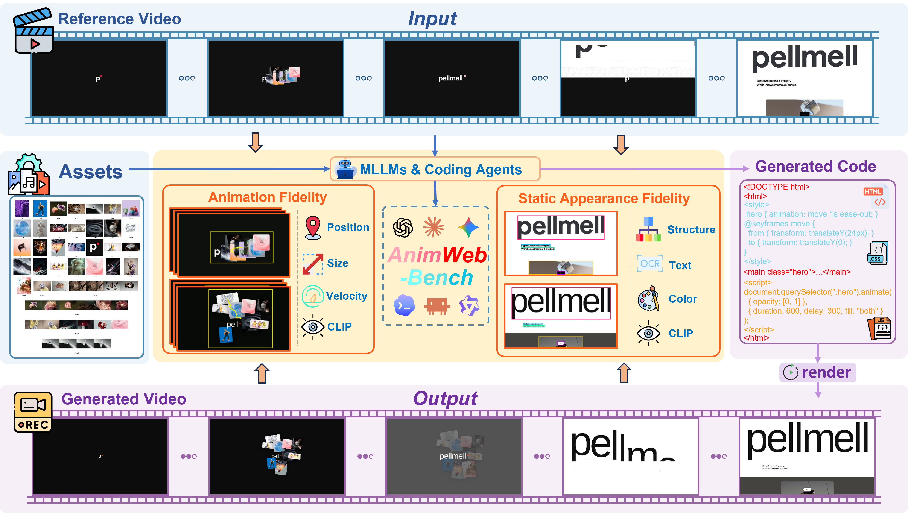

# AnimWeb-Bench: Benchmarking Animated Webpage Code Generation from Videos

## 📜 Abstract

Animation is pervasive on the Web, the CSS animation property alone appears on over three-quarters of webpages. Yet existing webpage code generation benchmarks target static screenshots, user-triggered interactions, or isolated motion graphics, leaving the ability of multimodal large language models (MLLMs) and coding agents to reconstruct complete animated webpages largely unexplored. To fill this gap, we introduce AnimWeb-Bench, the first benchmark for animated webpage code generation from videos.It comprises 124 real-world webpages spanning 7 application domains and 33 animation types, with 91.9% of pages combining multiple types, each paired with a reference video and the static assets of the original webpage. We further propose a human-aligned, two-dimensional evaluation protocol: Static Appearance Fidelity measures structure, text, color, and visual similarity on aligned keyframes, while Animation Fidelity tracks UI components across frames and compares their position, size, velocity, and appearance with those in the reference video.Evaluating 14 MLLMs and three coding agents reveals: (1) reproducing webpage animations is substantially more difficult than reproducing static appearance; (2) explicit frame inspection and render feedback improve the reconstruction quality of coding agents; and (3) rapid, continuous changes are harder to reproduce than discrete state transitions.



## 🛠️ Setup

### 1. Environment Setup

Install Node.js >= 22.12.0 (with npm) and system FFmpeg, ensuring `ffmpeg` and `ffprobe` are available on your `PATH` for evaluation. Then run:

```bash
git clone https://github.com/starry1001/AnimWeb.git
cd AnimWeb
pip install -r requirements.txt
npm install
```

`npm install` installs [Puppeteer](https://github.com/puppeteer/puppeteer) and [ffmpeg-static](https://github.com/eugeneware/ffmpeg-static), then downloads Chrome for headless recording.

### 2. Dataset Preparation

Download our dataset from [Huggingface Dataset](https://huggingface.co/datasets/starry1001/AnimWeb-Bench/tree/main) and place the extracted samples under `./data`. Each sample directory follows this structure:

```text
AnimWeb/
└── data/
    ├── 1/
    │   ├── assets/             # Original webpage assets
    │   ├── stitched_assets/    # Stitched asset images
    │   ├── ground_truth.html   # Reference webpage source
    │   ├── ground_truth.mp4    # Reference animation video
    │   └── metadata.json       # Sample ID and source URL
    ├── 2/
    └── ...
```

## 🚀 Generation

```bash
export OPENAI_API_KEY="Your_API_key"
export OPENAI_BASE_URL="Your_API_base_URL"

python generate.py \
  --data data \
  --result experiment \
  --model gpt-6-astra \
  --task-id 1-124 \
  --workers 1
```

## 🧪 Evaluation

```bash
python evaluate.py \
  --data data \
  --result experiment \
  --model gpt-6-astra \
  --task-id 1-124 \
  --device 0
```

<table align="center">
  <tr>
    <td align="center" width="520">
      <p><strong>UI Component Detection and Tracking</strong></p>
      <a href="assets/ui_component_trajectories.mp4">
        
      </a>
      <p>
        <sub>An illustration of UI component detection and tracking<br>across frames of an animated webpage.</sub>
      </p>
    </td>
  </tr>
</table>
